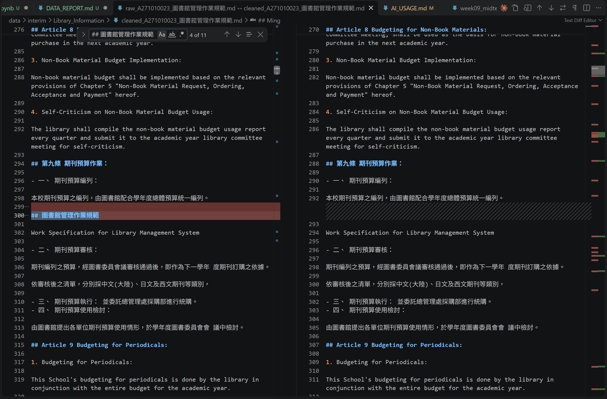
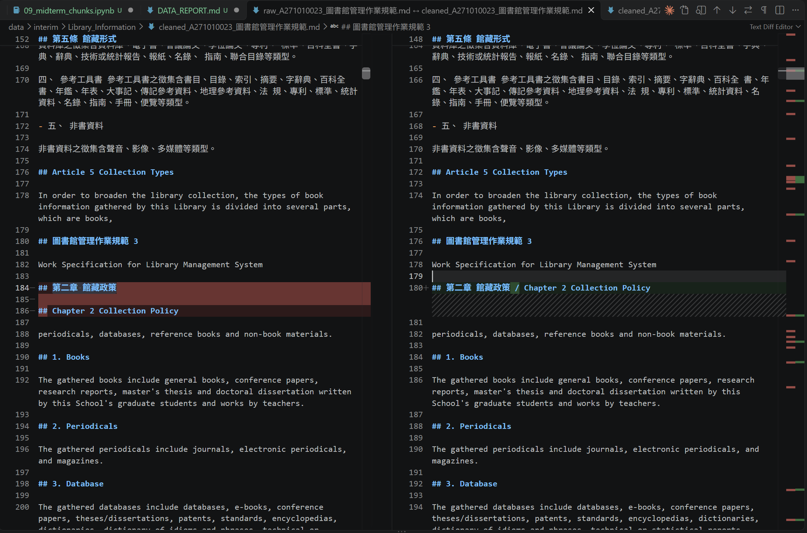
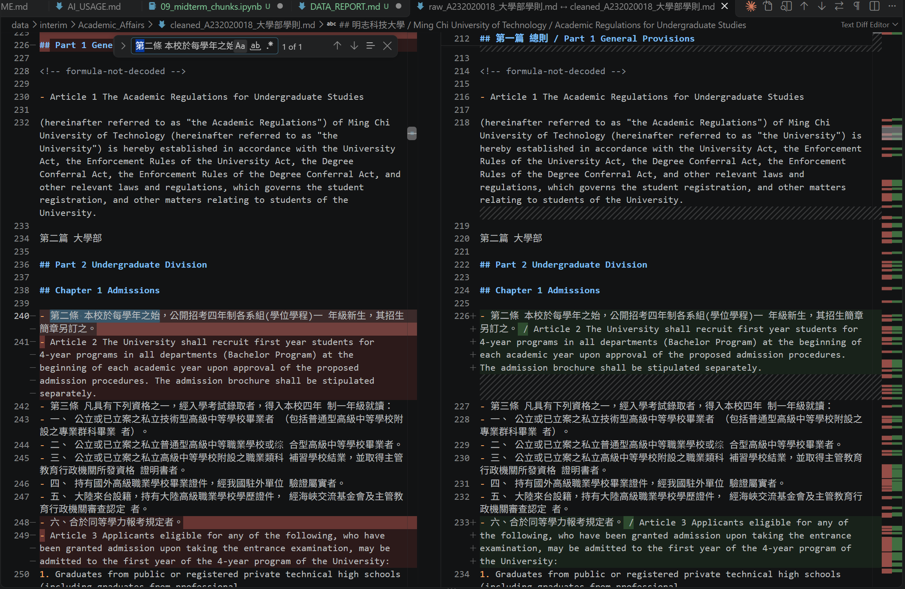
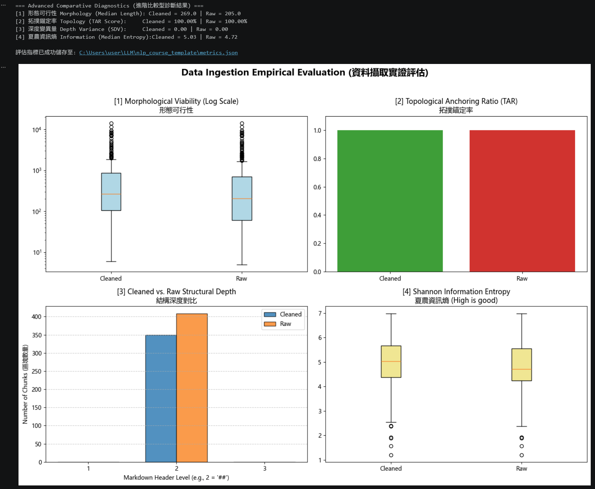

# 資料前處理報告 (Data Preparation Report)

- **學號 / 姓名**：U12627015/ 邱冠傑
- **專案名稱**：PDF 資料輸入與拓撲感知分塊
- **完成的任務**：- [x] 1-A 頁首頁尾清除　- [x] 1-B 雙語標題合併　- [x] 1-C 雙語條文合併

---

## 1. 資料集概覽 (Dataset Overview)

| 類別 (Cluster) | PDF 數量 | 清洗前 chunk 數 | 清洗後 chunk 數 |
|---|---|---|---|
| Academic_Affairs | 3 | 96 | 67 |
| Library_Information | 3 | 246 | 227 |
| Student_Affairs | 3 | 66 | 55 |
| **合計** | **9** | **408** | **349** |
**問題 (2–3 句)：** 清洗後 chunk 數量變少了多少？是哪個任務造成的？有沒有哪個任務**不影響** chunk 數量？為什麼？
清洗後 chunks 由 408 個減為 349 個，共減少 59 個（14.46%）。1-A 移除重複的 ## 頁首，1-B 合併中英文 ## 標題，因此會減少 chunks；1-C 不改動 ## 標題，所以不影響數量。

___

## 2. 清洗步驟 (Cleaning Steps)

### 2.1 任務 1-A：頁首頁尾溢出清除

- 檔名：`A271010023_圖書館管理作業規範.md`　搜尋的文字：`## 圖書館管理作業規範`
- 截圖 (存為 `reports/figures/1a_compare.png`)：
- 改變了什麼：刪除換頁時重複出現、整行只有文件名稱的頁首頁尾。
- 這對之後的問答檢索有什麼幫助：減少重複及沒有實質內容的標題，避免產生無意義的 chunks。
- 這個任務有沒有**改錯**的地方 (把不該改的也改了)？若有，寫出檔名與搜尋的文字；若沒有，寫「沒有發現」：沒有發現

### 2.2 任務 1-B：雙語標題合併

- 檔名：`A271010023_圖書館管理作業規範.md`　搜尋的文字：`第二章 館藏政策`
- 截圖 (存為 `reports/figures/1b_compare.png`)：
- 改變了什麼：將原本分成兩行的中文標題與英文標題，合併成 `## 第二章 館藏政策 / Chapter 2 Collection Policy`。
- 這對之後的問答檢索有什麼幫助：讓中英文標題位於同一個 chunk，使用中文或英文查詢時都較容易找到相同內容，並減少零碎 chunks。
- 這個任務有沒有**改錯**的地方 (把不該改的也改了)？若有，寫出檔名與搜尋的文字；若沒有，寫「沒有發現」：沒有發現

### 2.3 任務 1-C：雙語條文合併

- 檔名：`A232020018_大學部學則.md`　搜尋的文字：`第二條 本校於每學年之始`
- 截圖 (存為 `reports/figures/1c_compare.png`)：
- 改變了什麼：將原本分開的中文第二條與英文 `Article 2` 合併在同一行，中間加入 ` / `。
- 這對之後的問答檢索有什麼幫助：讓同一條文的中英文內容位於相同 chunk，提升中文與英文查詢的對應性。
- 這個任務有沒有**改錯**的地方 (把不該改的也改了)？若有，寫出檔名與搜尋的文字；若沒有，寫「沒有發現」：有。檔案 `cleaned_A232020018_大學部學則.md` 中搜尋 `六、合於同等學力報考規定者。 / Article 3`，可發現英文 Article 3 被接到中文條文的最後一個列點，而不是整條中文條文的開頭。

## 3. 評估指標與 AI 解讀查證 (Metrics & Verifying the AI's Interpretation)

### 3.1 指標數據表

| 指標 | Raw | Cleaned (你的) | Cleaned (參考值) |
|---|---|---|---|
| [1] 中位數長度 Median Length | 205.0 | 269.0 | 270.5 |
| [2] 拓撲錨定率 TAR | 100.00% | 100.00% | 1.0 |
| [3] 深度變異量 SDV (選填) | 0.00 | 0.00 | 0.00 |
| [4] 中位數資訊熵 Entropy (選填) | 4.72 | 5.03 | 5.06 |




你的 Cleaned 結果與參考值一致嗎？若一致，寫「一致」；若不一致，找出原因。
不完全一致；我的 TAR 與 SDV 一致，但文本長度中位數與資訊熵略低，可能是部分頁首及中英文條文未完全清理所致。

___

### 3.2 AI 的解讀

- 使用的 AI 工具：Codex Plus

清洗後的文本長度中位數由 205 增加至 269，表示雙語標題與條文合併後，chunks 較長且內容較集中。Raw 與 Cleaned 的拓撲錨定率皆為 100%，代表依目前程式定義，所有 chunks 都以 Markdown 標題開始。

兩組資料的標題深度變異量皆為 0，表示標題層級一致，但也可能代表文件階層被統一壓成相同層級。Cleaned 的資訊熵由 4.72 上升至 5.03，顯示字元內容較多元，但資訊熵較高不一定代表品質較好，仍需人工檢查頁首、表格及中英文條文是否正確。

### 3.3 你的查證 (至少兩點)

**查證 1**
- AI 的說法：清洗後的文本長度中位數由 205 增加至 269，表示 chunks 變得較長且內容較集中。
- 我查了什麼：專案根目錄的 `metrics.json`，以及 Notebook 中使用 `np.median()` 計算 `char_length` 的程式。
- 結論：部分正確，因為中位數確實由 205 增加至 269，但長度增加只能證明 chunks 變長，不能單獨證明內容品質或語意集中度提升。


**查證 2**
- AI 的說法：TAR 為 100%，代表所有 chunks 都以 Markdown 標題開始。
- 我查了什麼：Notebook 的 `get_tar()` 函式，以及 `cleaned_A231060004_學生申請期中停修課程實施要點_processed.json` 中索引 8 的 chunk。
- 結論：正確，但有侷限。`get_tar()` 確實只檢查文字是否以 `#` 開頭；索引 8 的 chunk 雖以 `## 明志科技大學` 開始，卻同時包含第八條與第九條，表示 TAR 100% 不代表標題與語意切塊完全正確。

### 3.4 實際證據：你被指定的 chunk

- **SEED**：1106

**(a) 很長的 chunk**
- 資料檔 (JSON)：`data/processed/Library_Information/cleaned_A271010023_圖書館管理作業規範_processed.json`　位置：第 **180** 個（從 0 開始數）　長度：**4812** 字元　驗證碼：`453fcc00`
- 閱讀用檔案 (`.md`)：`data/interim/Library_Information/cleaned_A271010023_圖書館管理作業規範.md`　從第 **1976** 行開始
- 前 3 行內容：
  ```text
  ## 表號：A071010823 / Personal Data Protection Statement for Collection, Processing, and Use, and Precautions for Borrowing

  1. Purpose for Collecting Personal Data
  ```
- 這是什麼樣的文字？為什麼會這麼長？這是一份圖書館個人資料保護聲明與借閱注意事項，包含八個主題及多個子項目。內部段落只使用數字編號，沒有新的 ## 標題，因此切塊程式將整份聲明保留在同一個 chunk。
- 之後做問答檢索時，這麼長的 chunk 可能造成什麼問題？過長的 chunk 包含多個主題，可能稀釋向量的語意重點、帶入不相關內容，並占用較多模型上下文。

**(b) 資訊熵很低的 chunk**
- 資料檔 (JSON)：`data/processed/Academic_Affairs/cleaned_A232060013_學生抵免學分辦法_processed.json`　位置：第 2 個（從 0 開始數）　資訊熵：2.39　驗證碼：`1a812751`
- 閱讀用檔案 (`.md`)：`data/interim/Academic_Affairs/cleaned_A232060013_學生抵免學分辦法.md`　從第 65 行開始
- 內容：
  ```text
  ## Table of Contents

  頁次

  Page

  | 第一條     | 依據                                                                                    |   1 |
  |------------|-----------------------------------------------------------------------------------------|-----|
  | Article 1  | Basis                                                                                   |     |
  | 第二條     | 適用對象                                                                                |   1 |
  | Article 2  | Applicability                                                                           |     |
  | 第三條     | 抵免學分數                                                                              |   2 |
  | Article 3  | Number of Credits for Transfer                                                          |     |
  | 第四條     | 科目抵免原則                                                                            |   4 |
  | Article 4  | Principles of Course Waiver and Credit Transfer                                         |     |
  | 第五條     | 新生抵免申請                                                                            |   6 |
  | Article 5  | Application for Credit Transfer and Course Waiver                                       |     |
  | 第六條     | 國外修課學分與成績登錄處理原則                                                          |   6 |
  | Article 6  | Regulations for the Transfer of Credits and Grade Registration for Courses Taken Abroad |     |
  | 第七條     | 科目替代                                                                                |   7 |
  | Article 7  | Subject substitution                                                                    |     |
  | 第八條     | 審核方式                                                                                |   7 |
  | Article 8  | Evaluation Methods                                                                      |     |
  | 第九條     | 注意事項                                                                                |   8 |
  | Article 8  | Dos and Don'ts                                                                          |     |
  | 第十條     | 相關規定                                                                                |   8 |
  | Article 9  | Unsettled Matters                                                                       |     |
  | 第十一條   | 實施與修訂                                                                              |   9 |
  | Article 10 | Implementation and Amendment                                                            |     |
  ```
- 為什麼它的資訊熵這麼低？它對問答檢索有用嗎？這是目錄表格，重複出現條號、`Article`、頁碼、空白及表格符號，因此字元分布集中、資訊熵較低。它可協助查詢章節名稱與頁碼，但缺乏法規正文，對具體問答的用途有限；英文條號錯位也可能干擾檢索。

## 4. 一個尚未解決的問題 (One Remaining Problem)

- **檔名** (`cleaned_*.md`)：`cleaned_A271010023_圖書館管理作業規範.md`　**從第 1610 行開始**　**標題**：`## Template for Western Book Purchase Requisition`
- **我是怎麼找到的**:看到 Docling 的表格配對警告後，在 cleaned Markdown 中搜尋「高單價圖書介購自評表」，並往前找到該 chunk 的 `##` 起始標題
- **問題 chunk (貼上部分內容)**：

```text
## Template for Western Book Purchase Requisition

Budge

Control

EIN

- [ ] □ Budgeted
- [ ] □ Budgetary
Transfer
- [ ] □ Others

35701534

| Ming |
|------|

| Acceptance Date | Invoice No. | Accountant Acceptance | President | Accounting Director | Library Director |
|-----------------|-------------|-----------------------|-----------|---------------------|------------------|

Form No. A071010223

| 高單價圖書介購自評表 - 申購部門預算來源 - 書名 | 高單價圖書介購自評表 - 作者、出版商、申請者意見等 | 出版年、版次、預估單價 | ISBN |
|------------------------------------------------|-------------------------------------------------------|------------------------|------|
```

- **問題是什麼**：西文圖書介購單與下一份高單價圖書介購自評表被放進同一個 chunk。部分文字被切斷，例如 `Budge`，`Ming` 也被錯誤辨識成單格表格，原始表格的欄列關係已遺失。
- **可能的原因** (PDF 本身？Docling 轉換？清洗的正則表示式？切塊規則？)：Docling 無法正確辨識複雜表單的合併儲存格及閱讀順序。raw 與 cleaned 檔案都有相同問題，因此不是後續正則清洗造成的。
- **具體的修正方法** (例如：一條規則、一個正則表示式的構想、長度上限)：針對複雜表單頁面調整或關閉表格結構辨識，並將 `Form No.`、`表號` 等文字設為強制切塊邊界，避免兩份表單進入同一個 chunk。
- **對問答檢索的影響**：不同表單的內容混在一起，可能讓查詢命中錯誤表單；表格欄位關係遺失，也會使模型無法正確回答 ISBN、申請人或審查意見等問題。

## 5. AI 協作 (AI Collaboration)

- 本次作業的 AI 協作紀錄請見 [`AI_USAGE.md`](AI_USAGE.md) 的「Week 04 / 08」與「Week 09」段落。
- 這次使用 AI 最大的收穫是提示詞中的「不能發生的事」與反例測試最關鍵；我也發現 AI 將 TAR 100% 解讀為結構良好並不完整，因為人工抽查後仍發現錯誤頁首、條文錯位及表格混合問題。
